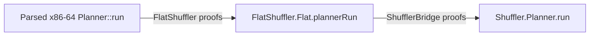

# Planner proof guide

The proof compares parsed x86-64 `Planner::run` with Lean `Shuffler.Planner.run`.
The input and machine conditions below must hold.
`PlannerResultMatchesModel` defines which results and data must agree.

With valid inputs, the method returns Done or Blocked. It cannot reach assertion
exit. Each Done result has a legal abstract trace to a stack that matches the
target. Blocked does not imply that no plan exists.

The proof does not cover `Shuffle::run` or concrete EVM execution.
It does not prove that a plan is optimal.

## Assumptions

`PlannerInputAssumptions` requires these conditions:

- Source and target sizes are at most `maxStackSize` (1024).
- Slot kinds are between 0 and 3.
- Junk and function return labels use their required encodings.
- Two input variable slots with equal payloads have equal encodings.
- All initial dropped bytes for the source are zero.

`PlannerInputsValidForNormalReturn` also requires these conditions:

- Each target value is junk, can be generated freely, occurs in the source, or
  is already spilled.
- The source has at least as many function return labels as the target.

`PlannerCallPrecondition` gives the register, buffer, spill-index, and memory
conditions. The initial trace must be empty. Owned memory regions must not
overlap. The stack must have 8240 free words plus a return slot.
Read the fields of this structure for all machine conditions.

Local arrays can have any initial values on each attempt.

## Proof layers and reading order



Read the first three files in this order. Use the other files for shared definitions.

| File | Content |
|---|---|
| [PlannerModel.lean](PlannerModel.lean) | Proves correctness of the Lean planner. Defines input conditions and compared results. Proves that the flat model has those results. |
| [PlannerAssembly.lean](PlannerAssembly.lean) | Defines call conditions and memory effects. Connects the call contracts to the instruction proof. |
| [Main.lean](Main.lean) | Combines the proofs. States agreement, normal return, property transfer, and correctness. |
| [PlannerInput.lean](PlannerInput.lean) | Defines inputs and flat execution. |
| [ValueEncoding.lean](ValueEncoding.lean) | Defines slot, spill, and trace conversions. |
| [NativeInterface.lean](NativeInterface.lean) | Defines object and buffer memory views. |

The assembly proof uses `FlatShuffler.plan_correct` in
[PlanFinal.lean](../FlatShuffler/PlanFinal.lean).
The proof from the flat model to the planner uses
`ShufflerBridge.Planner.plannerRun_corr` in
[Entry.lean](../ShufflerBridge/Planner/Entry.lean).

## Final theorem structure

All names below are in `ShufflerVerification`.
Each call contract takes an input condition and a postcondition.
The machine conditions in `PlannerCallPrecondition` also apply.

| Theorem in `Main.lean` | Claim |
|---|---|
| `planner_assembly_matches_model` | With `PlannerInputAssumptions`, assembly and model results agree. A model error corresponds to external `exit(1)`. |
| `planner_assembly_returns_normally` | With `PlannerInputsValidForNormalReturn`, the method returns Done or Blocked. It cannot reach assertion exit. |
| `planner_assembly_transfers_model_postcondition` | A proved model postcondition gives the same property for assembly. The input conditions must imply `PlannerInputAssumptions`. |
| `planner_assembly_returns_correct_plan_or_blocked` | With `PlannerInputsValidForNormalReturn`, the method returns Done or Blocked. Each Done result has a legal trace to a stack that matches the target. |

Each theorem has a `planner_binary_…` form. It uses the host from the recorded
binary layout. The assembly form requires a host with the proved methods and
`ExitBoundary`.

Normal return preserves the caller's memory frame and callee-saved registers.
The count word equals the trace length on Done and keeps its entry value on
Blocked. See `PlannerNormalReturn` for the full memory effects.

## Compared results

`PlannerResultMatchesModel` compares these data:

- Done and Blocked: whether each source or target variable is spilled, the
  spilling policy, active dropped bytes, and the wildcard-copy flag.
- Done also compares the active output stack, operation sequence, and original
  source index for each target position.
- Model error: only the failure outcome.

The comparison does not constrain unused buffer tails, padding, or model error
details. On Blocked, it does not compare the output stack, operation sequence,
or source indices.

`PlannerModelPostcondition post input` requires `post` to hold for every result
that satisfies `PlannerResultMatchesModel input`. The transfer theorem requires
a proof for all such results.

A matching stack has the target length. At each position without a target
wildcard, the output value equals the target value. The `Trace` type proves
that the abstract stack operations from the source are legal. Loads use the
final spill set. The proof does not establish the contents of spill memory.

## Proof inputs and trust

The build generates `build/kraken/c/build_bottom_up.S` from
`kraken/c/shuffler/stack/Shuffler.cpp`. Lean checks the parsed instructions.
Separate instruction and layout checks compare them with the method bytes in
`build/kraken/c/bbu_harness`. The proof does not cover the test driver or test
wrappers. Lean does not extract or decode the executable bytes.

The Lean proof does not verify the compiler, assembly parser, binary checks,
or hardware. It does not establish agreement with Solidity.
The general exit contract stops at external `exit` with argument 1.
It does not cover the implementation of `exit`.

The proofs use `propext`, `Classical.choice`, `Quot.sound`, and trusted
`bv_decide` axioms. The axiom audit checks the names and types of `bv_decide`
axioms. It rejects proof holes and other axioms.

Run these commands one at a time from the repository root in `nix develop`:

```sh
lake build
kraken/test/modules_test.sh
kraken/test/axioms.sh
kraken/test/bin_check.sh
kraken/test/bin_layout.sh --check
```

To use the public claims, start a Lean file with `module`, then
`import Theorems.Main`.
